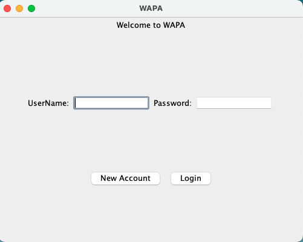
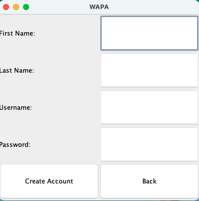
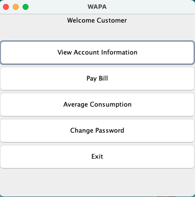
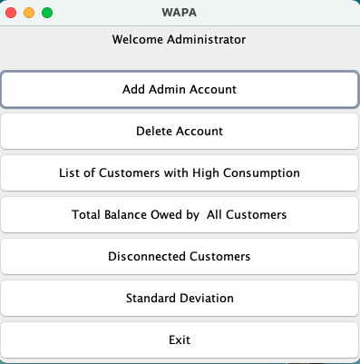
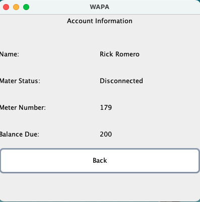
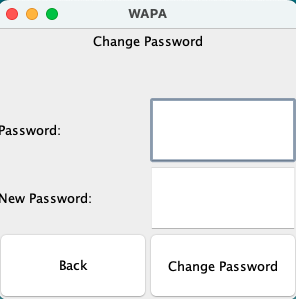
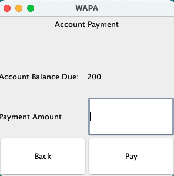
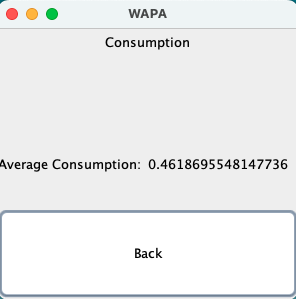

# Electric Company GUI App

A Java desktop app (Swing) for an electric company, modelled on my local power supplier: customers log in to see their consumption, account and bill, and an admin manages the accounts.

A school project from 2023: the first app I built in college.



## 📋 Table of Contents

1. 🖥️[Introduction](#introduction)
2. 🔍[Problem](#problem)
3. 💡[Solution](#solution)
4. 💻[Tech](#tech)
5. [Running it](#running-it)
6. [What I would do differently today](#what-i-would-do-differently-today)
7. 📝[Final Comments](#final-comments)
8. 🖼️[Graphics](#graphics)
9. 📫[Contact](#contact)
10. [Licence](#licence)

## <a name="introduction">🖥️ Introduction</a>

The following application is an adaptation implementation of a desktop app for my local power supplier company and was created for educational purposes.

The application uses Java's Swing toolkit to provide a Graphical User Interface experience. This was the first app I ever created during college and was used for a project.

I had limited knowledge back in the day and no access to database technologies, I had limited knowledge of database tools.

## <a name="problem">🔍 Problem</a>

I wanted to save data and use that data to create User accounts and Login, while the changes are made in real-time, without knowledge of a database.

## <a name="solution">💡 Solution</a>

I created my own personal database with the use of Binary and Txt Files. When creating an account I would write to a User txt file then I would implement a scanner to create the account based on data on each line, each line represents an account. Then I would create a binary file off that data and store inside a folder called database, the database folder would contain numerous accounts, starting from 0 to however many accounts there are with the .dat file extension. This allowed me to serialize objects into binary files and read but also update the objects into the binary files I am using, this resulted in real-time updates of accounts and data being saved whereas even if the application is closed when I return to it all the changed data remained. Please feel free to test it yourself, one feature that shines with this method was the change password page, which would update the password in the text file as well as in the binary file.

## <a name="tech">💻 Tech</a>

- **Language:** 
- **Data Storage:** , 
- **Serialization:** 
- **GUI:** 

## <a name="running-it">Running it</a>

You need a Java JDK (tested with OpenJDK 17 on macOS). From the repo folder:

```sh
javac -d out *.java
java -cp out LoginFrame
```

Run it from the repo folder: the app reads `Users` and the `database/` folder by relative path, and saves every change back to them, so using it changes those files.

## <a name="what-i-would-do-differently-today">What I would do differently today</a>

- **A build tool.** Maven or Gradle, so the project builds and runs with one command and states its Java version, instead of loose `.java` files at the root.
- **Tests.** Unit tests around creating an account, billing and changing a password, so a change can be checked without clicking through every window.
- **Passwords never stored as plain text.** Here they sit readable in `Users` and inside the `.dat` files. Today I would store only a salted hash from a slow algorithm such as bcrypt or Argon2.
- **A real database.** SQLite instead of a text file plus one serialized object per account: Java serialization stops reading the old files as soon as the class changes.

## <a name="final-comments">📝 Final Comments</a>

The program uses an object-oriented programming approach and is a skeleton app in which more features can be implemented, it also comes with admin side functionalities that pave the path to more updates in the future, allowing open-source contributions.

## <a name="graphics">🖼️ Graphics</a>

### <a name="login">Login</a>


### <a name="create-account">Create Account</a>


### <a name="customer-home">Customer Home</a>


### <a name="admin-home">Admin Home</a>


### <a name="customer-account-info">Customer Account Info</a>


### <a name="customer-change-password">Customer Change Password</a>


### <a name="customer-account-payment">Customer Account Payment</a>


### <a name="customer-consumption">Customer Consumption</a>


## <a name="contact" > 📫 Contact </a>
tomyfletcher99@hotmail.com
[](https://www.linkedin.com/in/tomy-romero-902476145/)

## <a name="licence">Licence</a>

The code is under the MIT licence: see [LICENSE](LICENSE).
